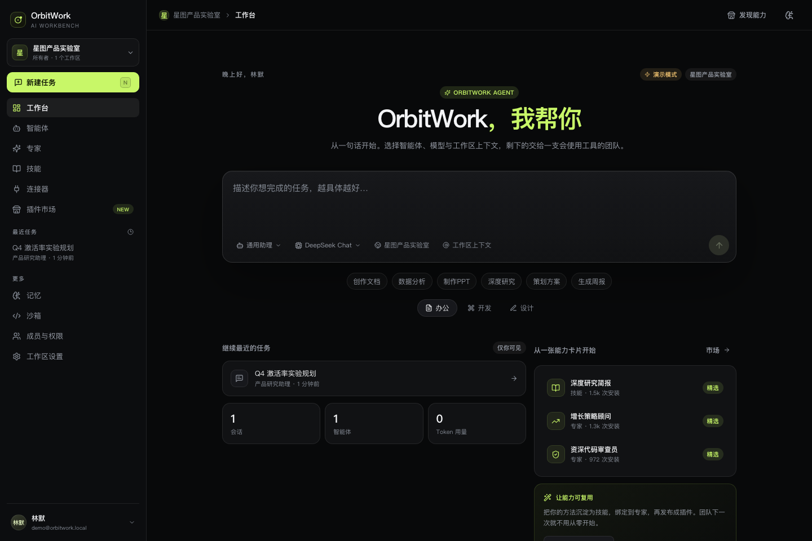

# OrbitWork

> 面向团队的 AI 智能体工作台 · 对话 × 专家 × 技能 × 连接器 × 插件市场
>
> 私有化部署 · Docker-first · 多租户权限隔离 · 支持任意 OpenAI 兼容模型



## 这是什么

OrbitWork 是一个可以在一台云主机上运行的团队 AI 工作台。它把 DeepSeek Harness 式的工作区原语（会话、模型、记忆、沙箱、工作区）与 WorkBuddy 式的任务体验组合起来，并增加了可发布、可安装的能力市场：

- **智能体工作台**：新建会话、SSE 流式、工具调用、取消、模型切换、Token 用量；会话仅创建者可见。
- **记忆**：显式事实卡、关键词注入、`save_memory` 工具、对象级授权。
- **沙箱**：独立 worker、串行、6 秒超时、资源上限；生产环境使用文件队列 + `network:none` 容器。
- **专家 / 技能 / 连接器**：可创建、发布、安装、收藏；专家一键启用为智能体。
- **插件市场**：把能力打包为插件，一键安装；不可变版本快照；管理员下架/恢复/精选。
- **多租户与治理**：scrypt 密码、服务端会话、工作区 RBAC、邀请、审计、平台管理后台。

## 快速开始（本地 Docker）

前置条件：Docker Engine 24+、Docker Compose v2。

```bash
cp .env.example .env
# 打开 .env，至少修改 APP_SECRET、SEED_ADMIN_PASSWORD、SEED_DEMO_PASSWORD
docker compose up -d --build
open http://localhost:8080
```

首次启动会创建管理员和示例市场资产。若在 `.env` 设置 `SEED_DEMO=true`（仓库内本地 `.env` 已启用），还会创建演示工作区。演示账号：

| 角色 | 邮箱 | 密码 |
|---|---|---|
| 演示用户 | `demo@orbitwork.local` | `Demo!2026`（以 `.env` 为准） |
| 平台管理员 | `admin@orbitwork.local` | `OrbitWork!Admin2026`（以 `.env` 为准） |

> 生产部署前必须修改所有 `CHANGE_ME` 与演示密码，执行 `SEED_DEMO=false`，并设置 `COOKIE_SECURE=true`、真实域名与 HTTPS。可先运行 `node scripts/preflight.mjs` 做环境自检。详见 [部署手册](docs/DEPLOYMENT.md)。

### 配置真实模型

```dotenv
LLM_BASE_URL=https://api.deepseek.com/v1
LLM_API_KEY=sk-...
LLM_MODELS=deepseek-chat:DeepSeek Chat,deepseek-reasoner:DeepSeek Reasoner
```

未配置 `LLM_API_KEY` 时自动进入演示模式：UI、权限、市场、沙箱全部可用，但回复为本地生成的示例文本，便于零成本验收。

## 本地开发（不用 Docker）

需要 Node.js 24+。

```bash
npm ci
npm run dev
```

打开 `http://127.0.0.1:8797`。`npm run dev` 使用独立的 `.data/dev.db`，并同时启动 API、客户端增量构建与 loopback 沙箱 worker。

其他命令：

```bash
npm run typecheck      # tsc --noEmit
NODE_ENV=test npm test # 23 项领域 + API 集成测试
npm run build          # 生产客户端 + 服务端 bundle
npm run start          # node dist/server.js（读取 .env）
```

## 架构一览

```
Caddy (TLS, SSE-friendly)
  └── app (Node 24 + Fastify + React SPA + SQLite WAL)
        ├── /app/.data/orbitwork.db    (named volume)
        └── /jobs/inbox|outbox         (file queue volume)
              └── sandbox (network:none, read-only, 256MB/0.5CPU, 6s)
```

- 单节点模块化单体，无外部数据库/缓存依赖。
- `node:sqlite` + WAL + 事务化版本迁移 + `VACUUM INTO` 备份。
- 16 张表覆盖身份、工作区、智能体、会话、运行、记忆、资产、版本、安装、收藏、审计。
- 前端由 esbuild 单次打包（约 200ms），无 Vite/Tailwind 工具链。
- 生产沙箱通过文件队列与 app 通信，**不共享网络**，无 Docker socket，无应用密钥。

详细设计、威胁模型、API 与部署说明：

- [产品文档（HTML）](docs/product.html)
- [架构与技术文档（HTML）](docs/architecture.html)
- [文档封面](docs/index.html)
- [部署手册](docs/DEPLOYMENT.md)
- [评审记录](docs/REVIEW.md)
- [架构笔记](docs/ARCHITECTURE.md)

## 安全说明

已实现：scrypt 密码哈希、HttpOnly 会话、工作区/对象级授权、聊天私有、Zod 校验、Origin + JSON Content-Type、账号级与 IP 级限流、AES-256-GCM 连接器密钥、SSRF 防护、不可变市场快照、平台审计、沙箱网络隔离。

V1 限制：无 MFA/SSO、无邮件找回、无 SSE 断线重放、SQLite 单节点、单 APP_SECRET 无轮换、连接器无按租户出口白名单。详见架构文档「技术债」。

## 目录

```
server/       Fastify API、领域规则、运行时、迁移、沙箱 worker
src/          React SPA 与设计系统
tests/        node:test + Fastify inject
docs/         产品/架构 HTML 文档、部署手册、评审记录、截图
scripts/      esbuild 构建、截图/冒烟脚本
Dockerfile    app 与 sandbox 共用镜像
docker-compose.yml
Caddyfile
```

## 已知交付边界

本仓库已完成代码、测试、构建与 Compose/Caddy 配置，并在本机完成 Node 运行时与浏览器端到端冒烟。当前构建环境没有 Docker daemon，因此 **`docker compose up` 未在本机实机运行**；上线前请按 `docs/DEPLOYMENT.md` 在目标 Docker/ECS 环境执行一次启动、TLS、流式与沙箱隔离冒烟。
